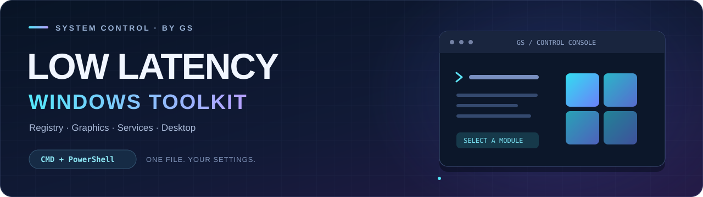

<div align="center">



# ⚡ Windows Optimizer by GS

**Настройки Windows, графики, сети и рабочего стола — в одном консольном меню.**


**v2.0.0-preview.1 · обновлённое меню, встроенные ресурсы и новая документация**

[📥 Открыть CMD v2](Low-Latency-Corp-Menu_v2.cmd) · [📝 История изменений](CHANGELOG.md) · [🔬 Сравнить версии](docs/COMPARISON.md)

[🚀 Запуск](#-быстрый-старт) · [🧩 Возможности](#-что-есть-в-меню) · [✨ Изменения v2](#-что-нового-в-v2) · [📦 Ресурсы](#-дополнительные-файлы-resources) · [🧪 Проверки](#-проверка-кода)

</div>

---

## 🎯 О проекте

**Low Latency Corp Menu** — набор настроек для ручной настройки Windows с упором на отклик системы, графику и удобство рабочего стола. Внутри CMD находится PowerShell-код: при запуске он извлекается во временный файл, открывает меню и выполняет выбранные действия.

Вы можете менять отдельные параметры или запускать пакет **Auto Registry Tweaks**. Пакет затрагивает много подсистем сразу; изучите его состав перед применением. Прирост FPS и снижение задержек **не гарантируются**: результат зависит от оборудования, драйверов и исходных настроек.

| 🖥️ Система | 🎮 Графика | 🌐 Сеть | 🪟 Рабочий стол |
| :---: | :---: | :---: | :---: |
| Службы · питание · приоритеты | AMD / NVIDIA · HAGS · FSO | Ethernet · MMCSS | Explorer · автозагрузка · QOL |


<p align="center"><sub>Схема изменений по коду. Это иллюстрация, а не скриншот работающего меню или замер производительности.</sub></p>

## 📂 Какой файл выбрать

| Файл | Назначение |
| :--- | :--- |
| **[Low-Latency-Corp-Menu_v2.cmd](Low-Latency-Corp-Menu_v2.cmd)** | Новая версия: предварительная проверка, подтверждения Auto/QOL, контроль размера загрузок. |
| [Low-Latency-Corp-Menu_SPI_24H2_VisualizationFix.cmd](Low-Latency-Corp-Menu_SPI_24H2_VisualizationFix.cmd) | **Оригинал, сохранён без изменений.** Нужен для сравнения и прежнего поведения. |
| [docs/COMPARISON.md](docs/COMPARISON.md) | Подробное сравнение оригинала и v2, включая ограничения. |
| [tests/Test-V2.ps1](tests/Test-V2.ps1) | Проверки новой логики без применения системных настроек. |
| [DEVICE-TWEAKER/](DEVICE-TWEAKER/) | Отдельный инструмент настройки устройств, добавленный в репозиторий. |
| [POWER-PLAN/LLC-CERTIFIED.pow](POWER-PLAN/LLC-CERTIFIED.pow) | Файл схемы питания, доступный через меню v2. |

> [!IMPORTANT]
> **В комплект уже входят Device Tweaker и схема питания.** v2 находит их в папках `DEVICE-TWEAKER` и `POWER-PLAN` рядом с CMD. Другие приложения, локальные установщики драйверов и профиль NVIDIA по-прежнему требуют дополнительных файлов в `Resources`. Существующая структура `Resources` имеет приоритет.

> **Windows 11 26H2:** совместимость не подтверждена; адаптация под неё в этот выпуск не включена. [Предварительный аудит →](docs/WINDOWS-26H2-RESEARCH.md)

## 🚀 Быстрый старт


### 1 · Подготовьте систему

- Целевая платформа проекта — **Windows 11**, в том числе настройки для 24H2. Полная совместимость всех пунктов с каждой сборкой Windows 10/11 не подтверждена.
- Для v2 нужен **64-битный Windows PowerShell 5.1** (`powershell.exe`). PowerShell 7 (`pwsh.exe`) не заменяет его для запуска меню.
- Для применения настроек нужна учётная запись с **правами администратора** и интерактивная консоль.
- Перед системными изменениями сохраните важные данные и подготовьте резервную копию или точку восстановления. Скрипт не создаёт их автоматически.

### 2 · Скачайте проект

На GitHub выберите **Code → Download ZIP**, распакуйте архив и откройте папку проекта. Также можно скачать сам CMD через кнопку **Download raw file** на его странице. Не сохраняйте HTML-страницу GitHub под расширением `.cmd`.

### 3 · Сначала выполните проверку

В обычной командной строке **CMD**, открытой в папке проекта:

```bat
Low-Latency-Corp-Menu_v2.cmd /check
```

В PowerShell используйте `./Low-Latency-Corp-Menu_v2.cmd /check`.

Этот режим проверяет синтаксис payload, тип и версию PowerShell, разрядность процесса, наличие каталога `Resources`, а также файлов запуска Device Tweaker и схемы питания рядом с CMD. **Права администратора не нужны, настройки Windows не меняются.** Создаётся только временный `.ps1`, который launcher затем удаляет.

| Код выхода `/check` | Значение |
| :---: | :--- |
| 🟢 `0` | Базовые требования к среде выполнены. Это не подтверждает совместимость каждого твика. |
| 🔴 `1` | Ошибка извлечения или разбора PowerShell-кода. |
| 🟠 `2` | Неподходящая среда; для неверных аргументов launcher тоже возвращает `2`. |

Отсутствие `Resources` выводится как предупреждение и **не меняет** успешный код проверки среды. Содержимое найденной папки и подлинность её файлов `/check` не проверяет.

### 4 · Откройте меню

Нажмите правой кнопкой по **`Low-Latency-Corp-Menu_v2.cmd` → «Запуск от имени администратора»**. Либо запустите файл без аргументов в уже повышенной CMD-консоли:

```bat
Low-Latency-Corp-Menu_v2.cmd
```

| Клавиша | Действие |
| :---: | :--- |
| `↑` / `↓` | Перемещение по пунктам |
| `Enter` | Выбор пункта |
| `Esc` | Выход из текущего меню / возврат |

Первый пункт v2 — **Preflight / About v2**. Для пакетного **Auto** требуется вручную ввести `AUTO`, для отдельного **QOL Optimize** — `QOL`. Пустой ввод или другой текст отменяет действие. Подтверждение Auto охватывает и QOL внутри пакета.

Справка по аргументам: `Low-Latency-Corp-Menu_v2.cmd /help`.

## 🧩 Что есть в меню

### ⚙️ Система и планировщик

| Раздел | Что делает |
| :--- | :--- |
| **UAC** | Включает или отключает контроль учётных записей заданными значениями реестра. Отключение снижает защиту Windows. |
| **Services** | Меняет типы запуска выбранных служб; обратный пункт выставляет встроенные `Start defaults`. |
| **Powersaving** | Отключает энергосбережение устройств; на ноутбуке это может увеличить расход батареи. |
| **Power Plan** | Импортирует и активирует включённую схему `POWER-PLAN/LLC-CERTIFIED.pow`; также поддерживает прежний путь через `Resources`. |
| **Win32PrioritySeparation** | Записывает значение `0x18`. |
| **Clock Interrupts → Core 0** | Записывает `SerializeTimerExpiration=1`. Название пункта не означает проверенную привязку всех прерываний к ядру 0. |

### 🎮 Графика и игры

| Раздел | Что делает |
| :--- | :--- |
| **Fullscreen Optimization** | Включает или отключает заданные параметры оптимизации полноэкранного режима. |
| **Gamebar and Game Mode** | Раздельно включает или отключает Game Bar и Game Mode. |
| **Hardware-Accelerated GPU Scheduling** | Включает или отключает HAGS через `HwSchMode`. Поддержка зависит от GPU и драйвера. |
| **GPU → AMD / NVIDIA** | Применяет наборы Optimize / Revert для соответствующего производителя. |
| **Drivers** | Предлагает внешние установщики и отдельные загрузки NVIDIA/AMD. Версии в URL фиксированы, это не поиск последних драйверов. |

### 🌐 Сеть и звук

| Раздел | Что делает |
| :--- | :--- |
| **Network Optimization** | Настраивает **проводной Ethernet** и энергосбережение адаптеров. Не следует считать это профилем для Wi-Fi. |
| **MMCSS** | Enable / Disable / Optimize / Fix Audio Stutters. В Auto выбор зависит от обнаруженного стека сетевого драйвера: NDIS или NetAdapterCx. |

### 🪟 Интерфейс и автозагрузка

| Раздел | Что делает |
| :--- | :--- |
| **QOL → Optimize** | Меняет Explorer, контекстное меню, Start/Search, анимации, доступность, ускорение мыши и политики Windows. |
| **Autostart** | Управляет Run/RunOnce, ярлыками Startup и загрузочными/входными триггерами задач. |
| **Apps** | Открывает включённый Device Tweaker; NPI, HIDUSBF, 7-Zip, Chrome и другие утилиты требуют отдельных файлов в `Resources`. |
| **Activate Windows** | Запускает внешний BAT из `Resources`. Встроенной активации в CMD нет; файл в репозиторий не включён. |

> [!WARNING]
> **QOL затрагивает не только текущий профиль:** загруженные и незагруженные пользовательские профили, шаблон Default и системные политики. Он отключает OneDrive без удаления приложения, чистит историю Explorer и сбрасывает закрепления панели задач, оставляя Explorer. Полного обратного пункта для QOL нет.

<details>
<summary><b>⚡ Что именно запускает Auto Registry Tweaks</b></summary>

Порядок действий сохранён из оригинала:

1. Отключение UAC.
2. QOL Optimize для профилей и системы.
3. Включение HAGS.
4. Выбор режима дисплея: сначала максимальная частота, затем разрешение при равной частоте.
5. Отключение Fullscreen Optimization, Game Bar и Game Mode.
6. Отключение выбранных служб.
7. Импорт и активация схемы питания.
8. Отключение энергосбережения устройств.
9. Network Optimization для проводного Ethernet.
10. MMCSS Auto.
11. `Win32PrioritySeparation = 0x18`.
12. Clock Interrupts → Core 0.
13. Импорт внешнего `.nip` через NVIDIA Profile Inspector.
14. GPU Auto.

Это **пакет системных изменений**, а не просто несколько косметических параметров реестра. Частичная ошибка не отменяет уже выполненные шаги. При отсутствии необходимых ресурсов отдельные шаги завершатся ошибкой; общий откат не выполняется.

</details>

## ✨ Что нового в v2

| | Оригинал | Новая версия |
| :--- | :--- | :--- |
| 🧭 Первый выбираемый пункт | Auto Registry Tweaks | Preflight / About v2 |
| 🔎 Проверка без применения настроек | Отдельного режима нет | `/check`, без администратора |
| 💬 Справка по запуску | Нет | `/help` и `/?` |
| ✋ Auto | Начинается после выбора пункта | Требует ввода `AUTO` |
| 👤 Отдельный QOL Optimize | Начинается после выбора пункта | Требует ввода `QOL` |
| 📥 Размер загрузки драйвера | Не сравнивается перед сохранением | Пустые загрузки и несовпадение известного размера отклоняются |
| 🔌 Device Tweaker и схема питания | Ожидаются внутри `Resources` | Также находятся в папках рядом с CMD |
| 🗃️ Старый CMD | Исходный файл | Сохранён без изменений рядом с v2 |

Наборы твиков и их значения **не переписаны**. v2 добавляет проверки вокруг существующих действий. Сверка размера загрузки не заменяет проверку цифровой подписи или контрольной суммы; если сервер не сообщает размер, полноту файла подтвердить нельзя.

**[Открыть подробное сравнение →](docs/COMPARISON.md)**

## 📦 Комплект и дополнительные файлы Resources

В репозиторий уже добавлены **Device Tweaker** и **схема питания**. Для них v2 сначала проверяет прежний путь `Resources\…`, затем соответствующий путь в корне проекта. Остальные инструменты ожидаются в папке **`Resources` рядом с CMD**. Переименование произвольного EXE не делает его подходящим ресурсом.

```text
claude-windows-optimizerbyGS/
├── Low-Latency-Corp-Menu_SPI_24H2_VisualizationFix.cmd  ← оригинал
├── Low-Latency-Corp-Menu_v2.cmd                        ← новая версия
├── README.md
├── DEVICE-TWEAKER/                                    ← включённый инструмент
│   ├── RUN-DEVICE-TWEAKER.bat
│   └── DEVICE-TWEAKER-UPDATE-2026-LLG-X-LLC-UPDATED.ps1
├── POWER-PLAN/
│   └── LLC-CERTIFIED.pow                              ← включённая схема
├── docs/
├── tests/
└── Resources/                                         ← отдельно, отсутствует в репозитории
    ├── POWER-PLAN/
    │   └── LLC-CERTIFIED.pow
    └── NVIDIA-PROFILE-INSPECTOR/
        ├── NVIDIA-PROFILE-INSPECTOR.exe
        └── LLC-OPTIMIZED-V3.nip
```

<details>
<summary><b>🧰 Примеры путей для внешних приложений</b></summary>

| Пункт | Ожидаемый путь относительно CMD |
| :--- | :--- |
| Device Tweaker | `Resources\DEVICE-TWEAKER\RUN-DEVICE-TWEAKER.bat` |
| Windows Defender Switcher | `Resources\WINDOWS-DEFENDER\RUN-WDS.bat` |
| Windows Update Blocker | `Resources\WINDOWS-UPDATES\RUN-WUB.bat` |
| HIDUSBF | `Resources\HIDUSBF\DRIVER\SETUP.exe` |
| 7-Zip | `Resources\7ZIP\7-Zip.exe` |
| Chrome | `Resources\CHROME\Chrome.exe` |
| Power Scheme Manager | `Resources\POWER-SCHEME-MANAGER\POWER-SCHEME-MANAGER.exe` |
| PresentMon CSV Plotter | `Resources\PRESENTMON-CSV-PLOTTER\PRESENTMON-CSV-PLOTTER.exe` |

Это часть ожидаемых путей. Для Device Tweaker v2 также использует включённый `DEVICE-TWEAKER\RUN-DEVICE-TWEAKER.bat`. Точные пути установщиков драйверов заданы в исходнике. Остальные перечисленные приложения не включены. Необязательный `pci.ids` рядом с CMD используется для уточнения названий GPU; справочник в `DEVICE-TWEAKER` относится к отдельному инструменту.

</details>

### 🔌 Что делает Device Tweaker

Это отдельный PowerShell-инструмент с графическим интерфейсом и собственным launcher. Он работает с MSI/MessageLimit, IRQ affinity/priority, RSS и параметрами устройств PCIe, USB и NVMe. Его наличие и запуск из меню не подтверждают полезность настроек для конкретного ПК.

В каталоге `RWEVERYTHING` есть установщик и REG-файлы. REG-файл `Apply-To-Fix-RWE-Driver-Loading.reg` отключает блокировку уязвимых драйверов, VBS/HVCI и связанные параметры защиты; **его импорт не является шагом установки этого обновления**. `RESET.reg` выставляет заданные автором значения, а не восстанавливает конфигурацию вашего ПК. Обработка RWEverything для NVMe по умолчанию отключена параметром `DisableRWEnNVMe`.

Существующие `device_settings_backup.json` и `logs/logging.txt` загружены вместе с инструментом. Это не резервная копия вашей системы; для восстановления нужны собственные данные, созданные на своём ПК.

## ↩️ Обратимость настроек

**Enable / Disable / Revert не равны восстановлению вашей прежней конфигурации.** Эти пункты часто записывают предопределённые значения или удаляют параметры. Например, Services возвращает встроенные типы запуска, а Network Disable удаляет используемые параметры, не сохраняя их прежние значения.

У менеджера автозагрузки есть собственные механизмы сохранения отключённых записей и ярлыков. Они относятся только к автозагрузке и не являются резервной копией Windows.

Скрипт не создаёт полный бэкап, не обеспечивает транзакционный откат и не восстанавливает автоматически успешно выполненные шаги после ошибки. Часть изменений требует выхода из сеанса или перезагрузки.

## 🧪 Проверка кода

Проверки новой логики запускаются без Pester и сторонних модулей:

```powershell
powershell.exe -NoProfile -File .\tests\Test-V2.ps1
```

Для статических проверок в Linux можно использовать PowerShell 7:

```sh
pwsh -NoProfile -File ./tests/Test-V2.ps1
```

Проверяется разбор обоих CMD-payload, подтверждения и отмена, границы размера загрузки, поиск включённых ресурсов и ранний выход режима проверки. Тесты не применяют твики Windows. Добавлен workflow GitHub Actions для Linux и Windows PowerShell 5.1; результат Windows CI следует смотреть в разделе Actions.

| 🟢 Пройдено | 🟡 Пропущено | 🖥️ Среда проверки |
| :---: | :---: | :---: |
| **49 проверок** | **2 проверки CMD в Windows** | Linux · PowerShell 7.4.13 |

**Граница проверки:** новая логика проверена в Linux с PowerShell 7.4.13; интерактивное меню, batch-launcher, реестр, службы, драйверы и применение настроек требуют отдельного испытания в Windows. Полноценное тестирование на Windows здесь не выполнялось.

## 🩺 Если что-то пошло не так

| Симптом | Что проверить |
| :--- | :--- |
| Требуются права администратора | Запустите CMD через «Запуск от имени администратора». |
| `/check` сообщает о неподходящем PowerShell | Используйте 64-битный **Windows PowerShell 5.1**, а не `pwsh`. |
| Не найден EXE / BAT / POW / NIP | Проверьте наличие ресурса и точное имя файла рядом с CMD. |
| Загрузка драйвера не удалась | URL фиксирован; проверьте доступность файла на официальном сайте производителя. |
| Часть защищённых ключей не изменилась | Изучите вывод, права и ошибку инициализации TrustedInstaller. Не считайте пакет применённым целиком. |
| Внешний вид не изменился сразу | Часть настроек применяется после повторного входа или перезагрузки. |

При обычном запуске отладочный журнал сохраняется в:

```text
%TEMP%\LowLatencyCorpMenu_Debug_<random>_<random>.log
```

При ошибке launcher показывает путь к журналу; `/check` завершается до запуска записи журнала. Перед публикацией лога просмотрите его: он может содержать имена пользователей и локальные пути.

---

<div align="center">

**🛠️ by GS · Настраивайте осознанно · Измеряйте результат на своём ПК**

[Новая версия](Low-Latency-Corp-Menu_v2.cmd) · [Оригинал](Low-Latency-Corp-Menu_SPI_24H2_VisualizationFix.cmd) · [Сравнение](docs/COMPARISON.md) · [Сообщить об ошибке](https://github.com/geraltschwarzenegger-svg/claude-windows-optimizerbyGS/issues)

</div>
