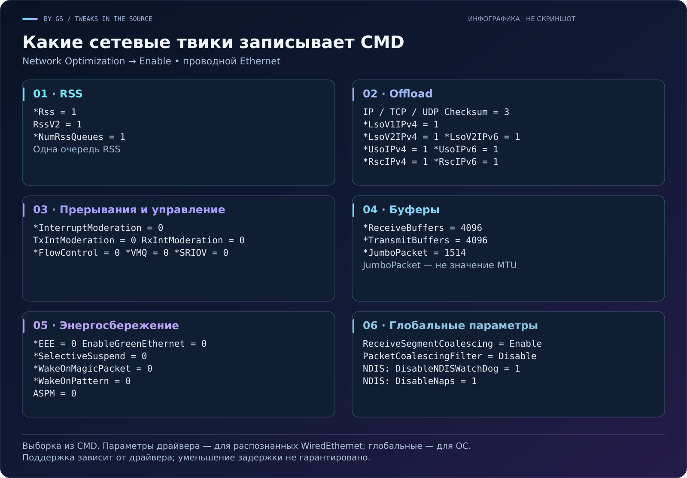

# 🌐 Какие сетевые настройки записывает CMD

[← README](../README.md) · [Исходный код v2](../Low-Latency-Corp-Menu_v2.cmd)

Это перечень **значений из кода**, а не отчёт об их применении на вашем ПК. Пункт **Network Optimization → Enable** запускает сначала `$DisablePowerSavingPayload`, затем `$OptimizeNetworkingPayload`. В Auto это отдельный шаг той же цепочки.

Параметры адаптеров записываются для всех найденных физических адаптеров, распознанных как `WiredEthernet`. Wi-Fi и прочие типы пропускаются. Глобальные команды и DWORD NDIS запускаются при наличии хотя бы одного такого Ethernet-адаптера; их действие не ограничивается одним интерфейсом.

Отсутствующие значения также создаются. Запись ключа не доказывает поддержку параметра драйвером. Код не устанавливает, какие из этих значений дадут улучшение на конкретном оборудовании.

## 🧭 Быстрая карта



## 1 · Параметры драйвера адаптера — 57 значений

Реестр класса сетевого адаптера: `HKLM\SYSTEM\CurrentControlSet\Control\Class\{4d36e972-e325-11ce-bfc1-08002be10318}\<номер>`.

Новые значения создаются как `REG_SZ`. Для существующих код сохраняет поддерживаемый тип значения, поэтому число в таблице — значение, а не обещание универсального DWORD-типа. `*JumboPacket=1514` — параметр драйвера; его нельзя подписывать как «MTU 1514».

| Параметр | Значение |
| :--- | :--- |
| `*EncapsulatedPacketTaskOffloadNvgre` | `1` |
| `*EncapsulatedPacketTaskOffloadVxlan` | `1` |
| `*EncapsulatedPacketTaskOffload` | `1` |
| `*IPChecksumOffloadIPv4` | `3` |
| `*LsoV1IPv4` | `1` |
| `*LsoV2IPv4` | `1` |
| `*LsoV2IPv6` | `1` |
| `*TCPChecksumOffloadIPv4` | `3` |
| `*TCPChecksumOffloadIPv6` | `3` |
| `*UDPChecksumOffloadIPv4` | `3` |
| `*UDPChecksumOffloadIPv6` | `3` |
| `*IPsecOffloadV1IPv4` | `3` |
| `*IPsecOffloadV2` | `3` |
| `*IPsecOffloadV2IPv4` | `3` |
| `*TCPConnectionOffloadIPv4` | `1` |
| `*TCPConnectionOffloadIPv6` | `1` |
| `*TCPUDPChecksumOffloadIPv4` | `3` |
| `*TCPUDPChecksumOffloadIPv6` | `3` |
| `*UsoIPv4` | `1` |
| `*UsoIPv6` | `1` |
| `TeredoOffload` | `1` |
| `*QoSOffload` | `1` |
| `*Rss` | `1` |
| `*NumRssQueues` | `1` |
| `RssV2` | `1` |
| `*VMQ` | `0` |
| `VMQSupported` | `0` |
| `*FlowControl` | `0` |
| `FecMode` | `0` |
| `*RscIPv4` | `1` |
| `*RscIPv6` | `1` |
| `ForceRscEnabled` | `1` |
| `*UdpRsc` | `1` |
| `*InterruptModeration` | `0` |
| `TxIntModeration` | `0` |
| `RxIntModeration` | `0` |
| `*JumboPacket` | `1514` |
| `DisableLLDP` | `1` |
| `*HeaderDataSplit` | `1` |
| `HDSplitAlways` | `1` |
| `*ReceiveBuffers` | `4096` |
| `StoreBadPackets` | `0` |
| `RecvCompletionMethod` | `4` |
| `AsyncReceiveIndicate` | `2` |
| `ThreadedDpcEnable` | `0` |
| `*TransmitBuffers` | `4096` |
| `DropHighlyFragmentedPacket` | `1` |
| `EnableCoalesce` | `0` |
| `TxThreadedDpcEnable` | `0` |
| `SendCompletionMethod` | `2` |
| `ThreadPoll` | `200000` |
| `*PacketCoalescing` | `0` |
| `*PacketDirect` | `1` |
| `*NdisPoll` | `1` |
| `*NetworkDirect` | `0` |
| `CongestionMonitoringEnable` | `0` |
| `*SRIOV` | `0` |

## 2 · Глобальные параметры offload — 2 команды

```powershell
Set-NetOffloadGlobalSetting -ReceiveSegmentCoalescing Enable
Set-NetOffloadGlobalSetting -PacketCoalescingFilter Disable
```

Это настройки ОС, а не только выбранного адаптера.

## 3 · Параметры NDIS — 7 DWORD

Путь: `HKLM\SYSTEM\CurrentControlSet\Services\NDIS\Parameters`.

| Параметр | Значение |
| :--- | :--- |
| `DisableNDISWatchDog` | `1` |
| `DisableNaps` | `1` |
| `NoPauseOnSuspend` | `1` |
| `DebugLoggingMode` | `0` |
| `DisableWDIWatchdogForceBugcheck` | `1` |
| `DisableReenumerationTimeoutBugcheck` | `1` |
| `EnableNicAutoPowerSaverInSleepStudy` | `0` |

## 4 · Сетевое энергосбережение — 60 строковых значений

Тот же реестр класса найденных физических `WiredEthernet`-адаптеров. Эта часть использует строковые значения `REG_SZ`.

| Параметр | Значение |
| :--- | :--- |
| `*DeviceSleepOnDisconnect` | `0` |
| `*WakeOnMagicPacket` | `0` |
| `*WakeOnPattern` | `0` |
| `*NicAutoPowerSaver` | `0` |
| `EEELinkAdvertisement` | `0` |
| `EnableModernStandby` | `0` |
| `EnablePowerManagement` | `0` |
| `EnablePME` | `0` |
| `ForceWakeFromMagicPacketOnModernStandby` | `0` |
| `WakeFromS5` | `0` |
| `WakeOn` | `0` |
| `WakeOnLink` | `0` |
| `LinkNegotiationProcess` | `0` |
| `WaitForValidPhyIDRead` | `0` |
| `WaitAutoNegComplete` | `0` |
| `SleepWhileWaiting` | `0` |
| `EnableETW` | `0` |
| `OBFFEnabled` | `0` |
| `ULPMode` | `0` |
| `I218DisablePLLShut` | `1` |
| `I218DisablePLLShutGiga` | `1` |
| `I219DisableK1Off` | `1` |
| `DisableDelayedPowerUp` | `1` |
| `*EEE` | `0` |
| `DisableIntelRST` | `1` |
| `ForceHostExitUlp` | `1` |
| `ForceLtrValue` | `0` |
| `EnableDisconnectedStandby` | `0` |
| `DMACoalescing` | `0` |
| `EnableWakeOnManagmentOnTCO` | `0` |
| `EnablePHYFlexibleSpeed` | `0` |
| `EnablePHYWakeUp` | `0` |
| `EnableD0PHYFlexibleSpeed` | `0` |
| `EnableSavePowerNow` | `0` |
| `AutoPowerSaveModeEnabled` | `0` |
| `SipsEnabled` | `0` |
| `WakeOnFastStartup` | `0` |
| `ReduceSpeedOnPowerDown` | `0` |
| `*EnableDynamicPowerGating` | `0` |
| `EnableD3ColdInS0` | `0` |
| `*SSIdleTimeout` | `1` |
| `*SSIdleTimeoutScreenOff` | `1` |
| `SSIdleTimeoutMS` | `1` |
| `LatencyToleranceReporting` | `0` |
| `*SelectiveSuspend` | `0` |
| `*IdleRestriction` | `1` |
| `AdvancedEEE` | `0` |
| `ASPM` | `0` |
| `CLKREQ` | `0` |
| `EEEPlus` | `0` |
| `EnableAspm` | `0` |
| `DynamicLTR` | `0` |
| `EnableGreenEthernet` | `0` |
| `GigaLite` | `0` |
| `PowerDownPll` | `0` |
| `PowerSavingMode` | `0` |
| `WolShutdownLinkSpeed` | `2` |
| `LTROBFF` | `0` |
| `S0MgcPkt` | `0` |
| `S5WakeOnLan` | `0` |

## 5 · Сетевое энергосбережение — 3 DWORD

| Параметр | Значение |
| :--- | :--- |
| `HwOption` | `0x00C00000` |
| `HwOptionV2` | `0x00000004` |
| `HwOptionV3` | `0x00040000` |

## Что относится к другим пунктам меню

- **MMCSS** — отдельный пункт и отдельный шаг Auto. Для NDIS Auto включает службу (`Start=2`) и применяет Optimize; для NetAdapterCx отключает её (`Start=4`). При смешанном наборе драйверов запрашивается выбор. В Optimize `NetworkThrottlingIndex=10`; это не универсальный сетевой параметр из Network Enable.
- **Powersaving → Disable device powersaving** — более широкий набор действий для устройств, WMI, wake-параметров, сетевых адаптеров и USB. Он не ограничен описанным здесь Ethernet-профилем.
- **Device Tweaker** — отдельный инструмент со своими функциями. Его параметры нельзя считать частью встроенного Network Enable.

## Отключение и результат

`Network Optimization → Disable` удаляет перечисленные значения драйвера и NDIS, не восстанавливая их прежние пользовательские значения. Глобальные `Set-NetOffloadGlobalSetting` эта ветка назад не возвращает. Полного автоматического отката нет.

Изменения могут повлиять на Wake-on-LAN, энергопотребление, нагрузку CPU и пропускную способность. Меньший ping, более высокая скорость интернета или снижение задержки не гарантируются. Реальный результат нужно проверять на своём ПК и драйвере.
